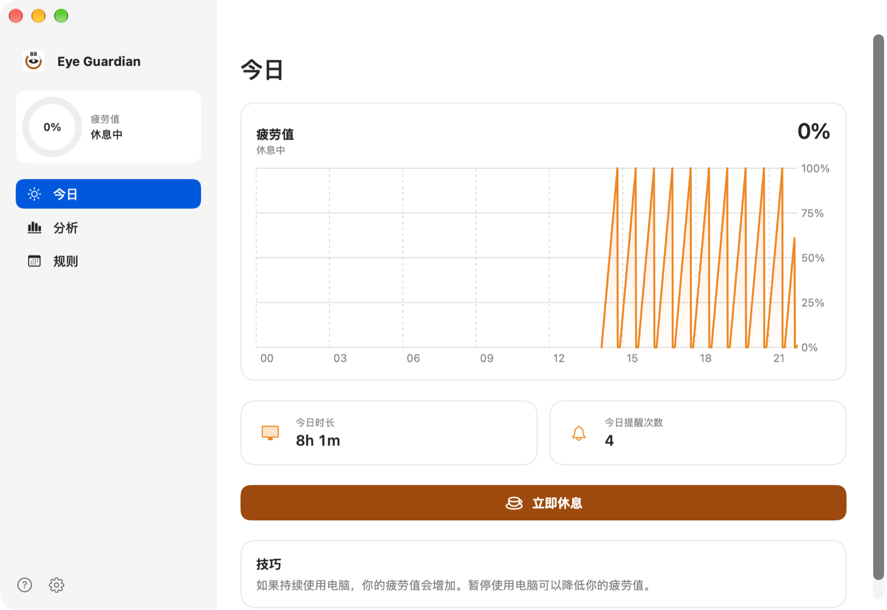
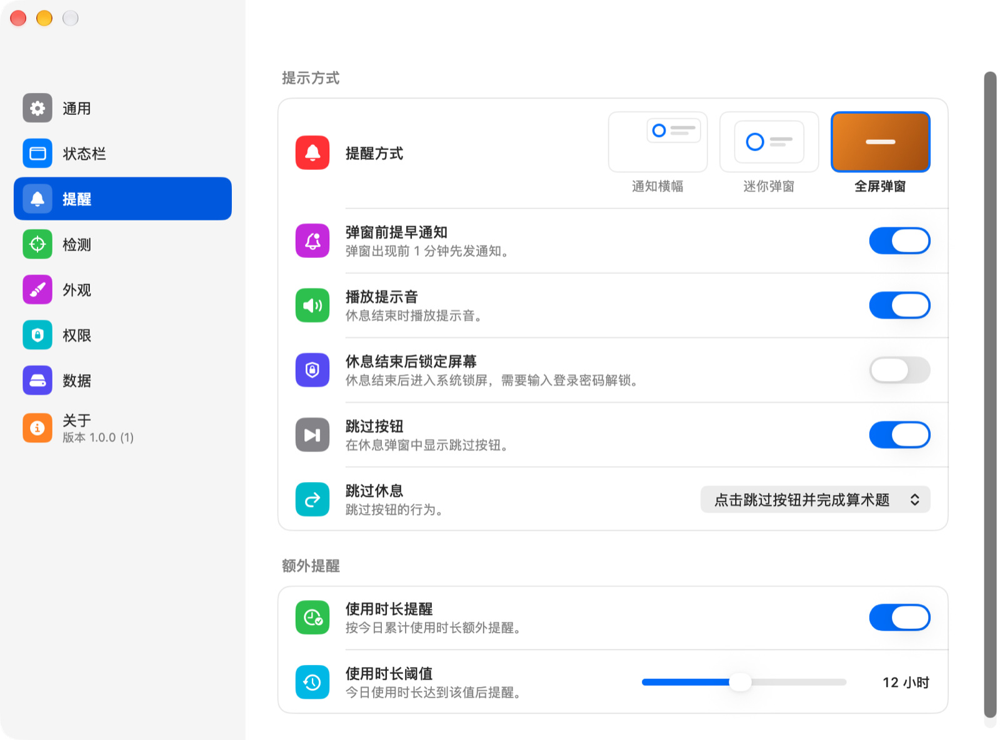
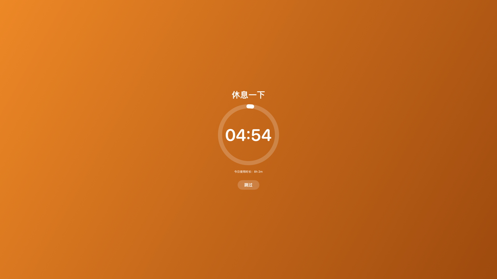
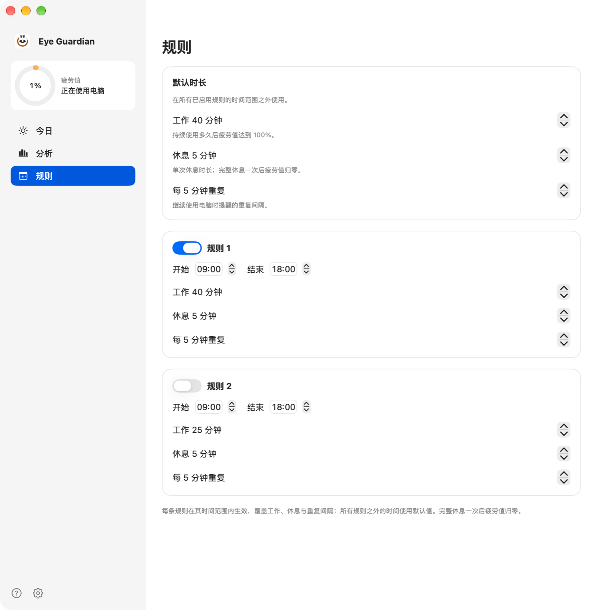
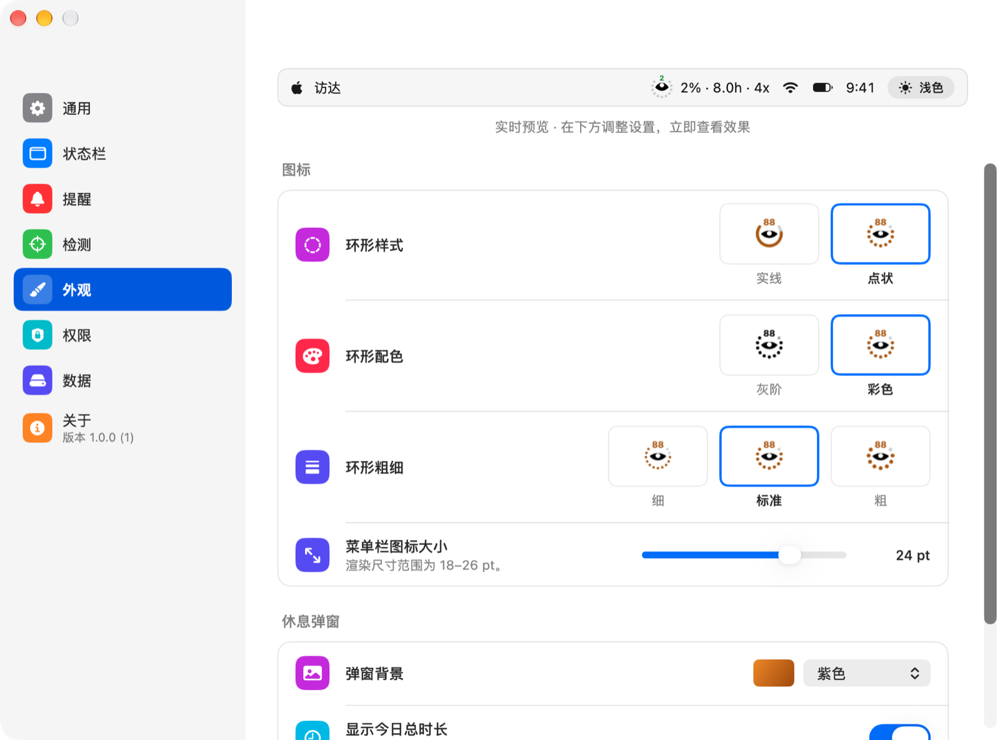
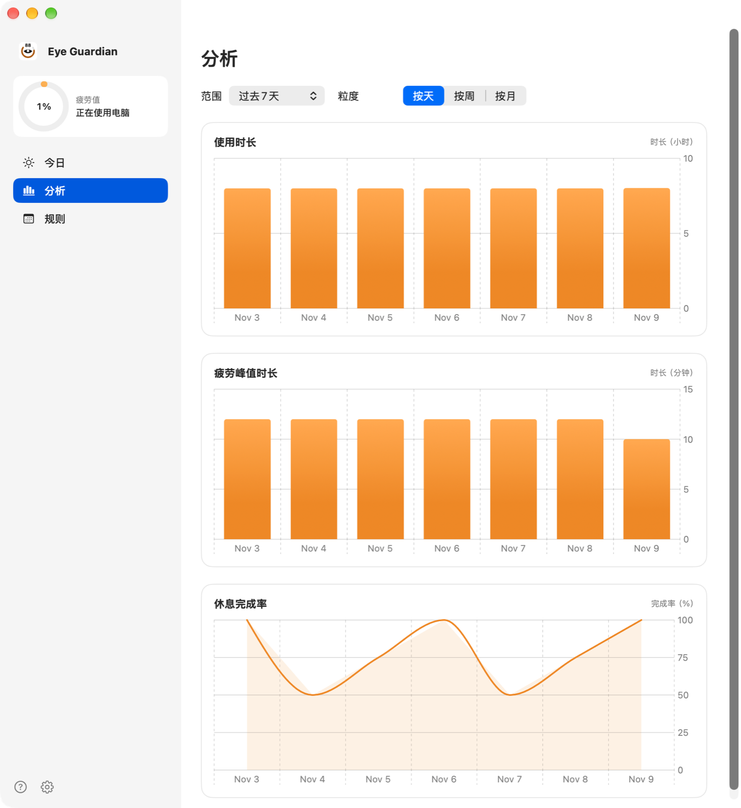

# Eye Guardian

Eye Guardian 是一个 macOS 原生休息提醒应用。它根据使用电脑的时间累积疲劳值，达到阈值后提醒休息；休息结束后疲劳值归零。使用 SwiftUI、AppKit 和 Swift Charts 编写，支持 macOS 13 及以上，提供 arm64 与 x86_64 通用二进制，没有第三方依赖。

应用不需要账号，使用记录只保存在本机。界面支持 English 和简体中文。

## 功能

### 疲劳值

默认工作 40 分钟后疲劳值达到 100%，休息 5 分钟可以完全恢复。两个时长都可以调整。疲劳值到达 100% 时提醒；未休息会按重复间隔再次提醒。

使用检测决定疲劳值何时上升：

- 智能模式：鼠标、键盘或屏幕变化在 60 秒内有活动，算在使用；60 秒没有活动，算在休息。
- 愚钝模式：解锁期间全部算在使用。
- 观影模式：忽略输入检测，看视频时也继续计时。

鼠标和触摸板不需要额外权限；键盘需要辅助功能权限；屏幕变化检测需要屏幕录制权限。锁屏和睡眠始终算在休息。

### 提醒方式

- 通知横幅：在通知中心显示，可以直接开始休息或跳过。
- 迷你弹窗：停靠在屏幕右上角，不占满整个屏幕。
- 全屏弹窗：覆盖所有屏幕。除非跳过，否则倒计时结束前会一直显示。

选择弹窗样式时，可以在提醒出现前 1 分钟收到预告通知。弹窗背景可以选择跟随系统、浅色、深色、紫色或自定义图片；提醒文案和是否显示今日使用时长也可以修改。设置中还可以按今日累计使用时长再提醒一次，例如达到 12 小时时通知。

### 跳过与休息结束

跳过休息有三种设置：

- 点击跳过按钮直接结束休息。
- 先完成一道乘法题。
- 不提供跳过按钮。

休息结束时会播放提示音。开启“休息结束后锁定屏幕”后，系统会立即进入锁屏。

### 分时段规则

规则页可以按时间段设置工作、休息和重复间隔。规则之外的时间使用默认时长；时间段支持跨午夜。规则按顺序匹配，第一条启用的规则生效。

### 状态图标与快捷键

菜单栏或程序坞图标会显示疲劳进度环。图标样式可以切换实线或点状、灰阶或彩色、三种粗细，尺寸可以在 18–26 pt 之间调整。图标旁可以显示疲劳百分比、今日使用时长和今日提醒次数；暂停提醒时图标会带暂停标记。

左键点击菜单栏图标打开暂停菜单，可以暂停 30 分钟、1 小时、2 小时、6 小时或到明天；右键打开完整菜单。快捷键 ⌃⌥⌘B 可以在任意应用中开始休息。

### 记录与分析

今日页显示疲劳值曲线、今日使用时长和提醒次数。分析页提供三个图表：使用时长、疲劳值达到 100% 的累计时长和休息完成率。时间范围可选最近 7 天、28 天、90 天、12 个月或全部时间，粒度可选按天、按周、按月。

数据可以导出为 CSV，按天汇总使用分钟数、疲劳峰值分钟数、提醒次数、完成次数和完成率。

## 安装

需要 macOS 13 或更高版本，以及 Swift 6 的 Command Line Tools；不需要完整 Xcode。

| 命令 | 作用 |
| --- | --- |
| `make` | 构建 arm64 与 x86_64 通用版本，组装并签名 `build/Eye Guardian.app` |
| `make run` | 构建后打开应用 |
| `make test` | 运行 Core 层测试 |
| `make dmg` | 生成可拖入“应用程序”的磁盘映像 |
| `make clean` | 删除构建产物 |

第一次构建会用 `openssl` 创建本地代码签名证书，导入 `~/Library/Keychains/EyeGuardian.keychain-db`，并设为信任。签名身份不变，重新构建后辅助功能和屏幕录制授权继续有效。删除该钥匙串会更换身份，需要重新授权。设置 `CODESIGN_ID` 环境变量可以使用其他签名身份。

## 权限

- 辅助功能：读取全局键盘输入。未授权时只统计鼠标和触摸板。
- 屏幕录制：只有开启“监测屏幕内容变化”时才使用。检测结果是 32×20 的灰度指纹，只保留在内存中。
- 通知：显示通知横幅和预告提醒。首次启动时请求。

系统设置或应用内提示都可以打开对应权限。

## 使用

启动后显示主窗口。语言默认跟随系统，可以在“设置 → 通用”中固定为 English 或简体中文，修改立即生效。可以选择登录时启动。

“设置 → 提醒”调整提醒方式、预告通知、跳过行为、提示音、锁屏和额外提醒；“设置 → 检测”调整使用检测；“设置 → 状态栏”和“设置 → 外观”调整图标与弹窗。这些页面顶部的预览会随修改更新。

## 数据与隐私

使用记录保存在 `~/Library/Application Support/EyeGuardian/events.sqlite3`。数据库每分钟写入一条记录，包含疲劳值和当时是否在使用；提醒的开始与完成时间也会记录。应用不上传这些数据。

屏幕变化检测只在本机内存中比较缩略图，不写入磁盘。关闭该功能后不会截取屏幕。

## 项目结构

| 路径 | 内容 |
| --- | --- |
| `Sources/EyeGuardian/Core` | 设置、疲劳计算、调度、规则、SQLite 存储、CSV 导出 |
| `Sources/EyeGuardian/Platform` | 事件监测、权限、状态栏、程序坞图标、窗口、锁屏 |
| `Sources/EyeGuardian/UI` | SwiftUI 界面 |
| `Sources/EyeGuardianApp` | 程序入口 |
| `Tests` | Core 层测试 |
| `scripts/build.swift` | 通用构建、图标生成、签名、磁盘映像 |

## 开发

Core 层不依赖 AppKit，测试使用 Swift Testing。`make test` 会为 Command Line Tools 补上 Swift Testing 的插件与框架搜索路径；直接执行 `swift test` 可能找不到 `Testing` 模块。

`swift build` 只编译当前架构的调试版本；生成可分发的应用和磁盘映像使用 `make`。

## 许可证

本项目采用 GNU Affero General Public License v3.0（AGPL-3.0），全文见 [LICENSE](LICENSE)。
