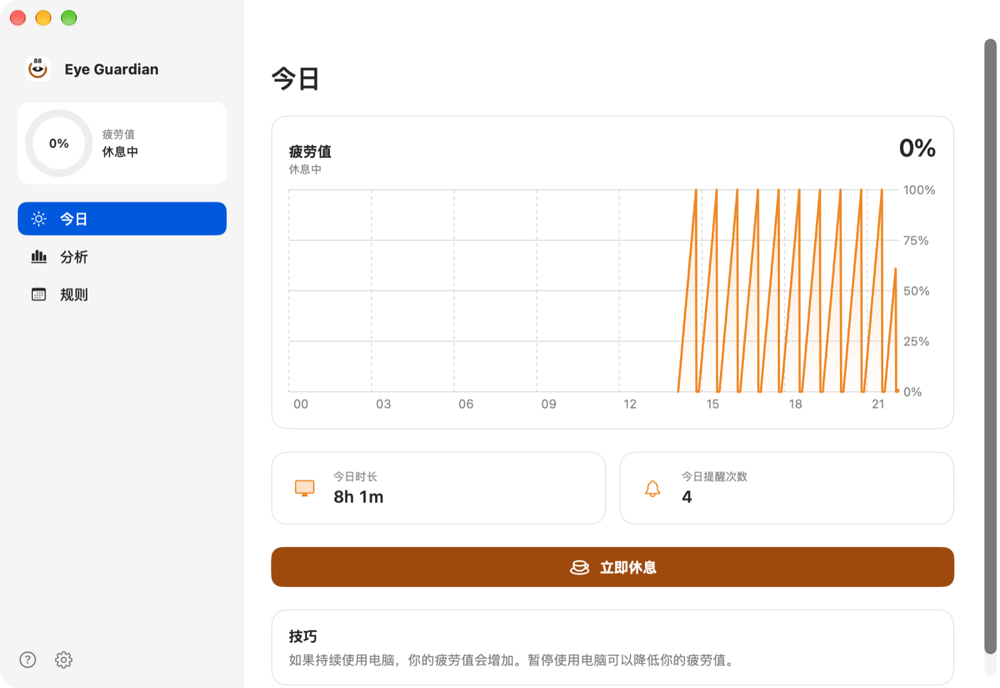
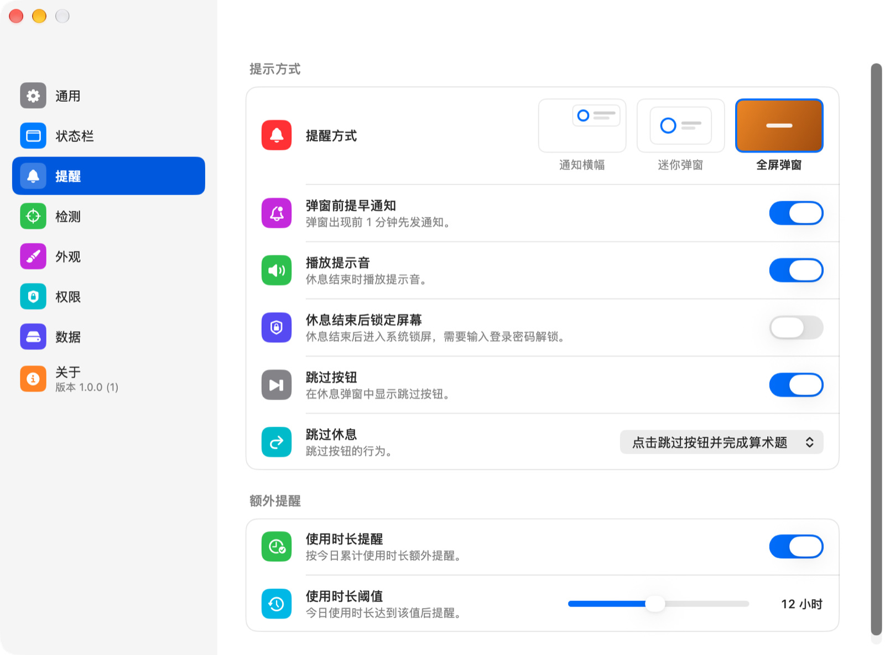
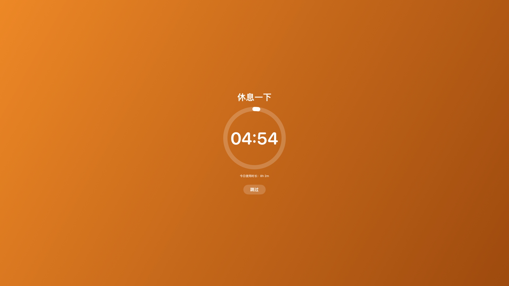
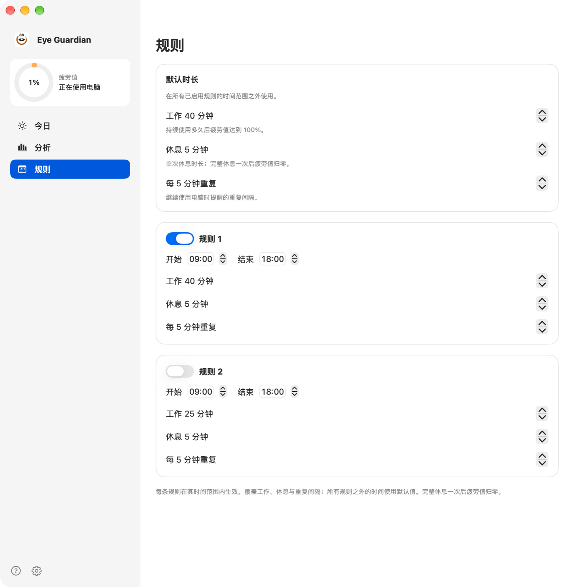
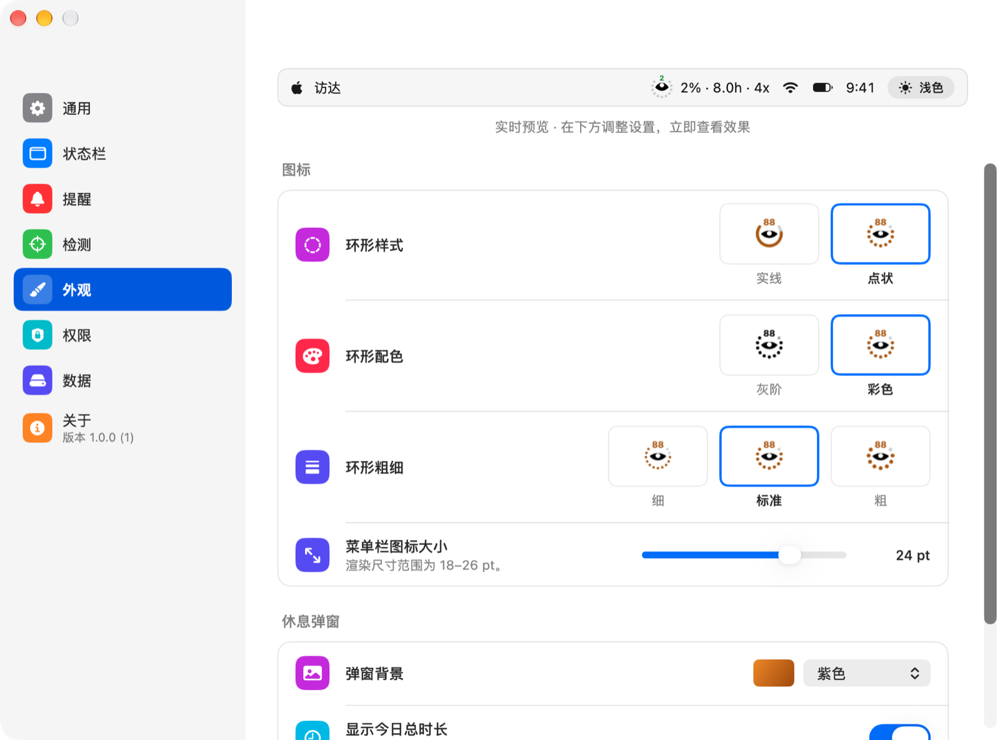
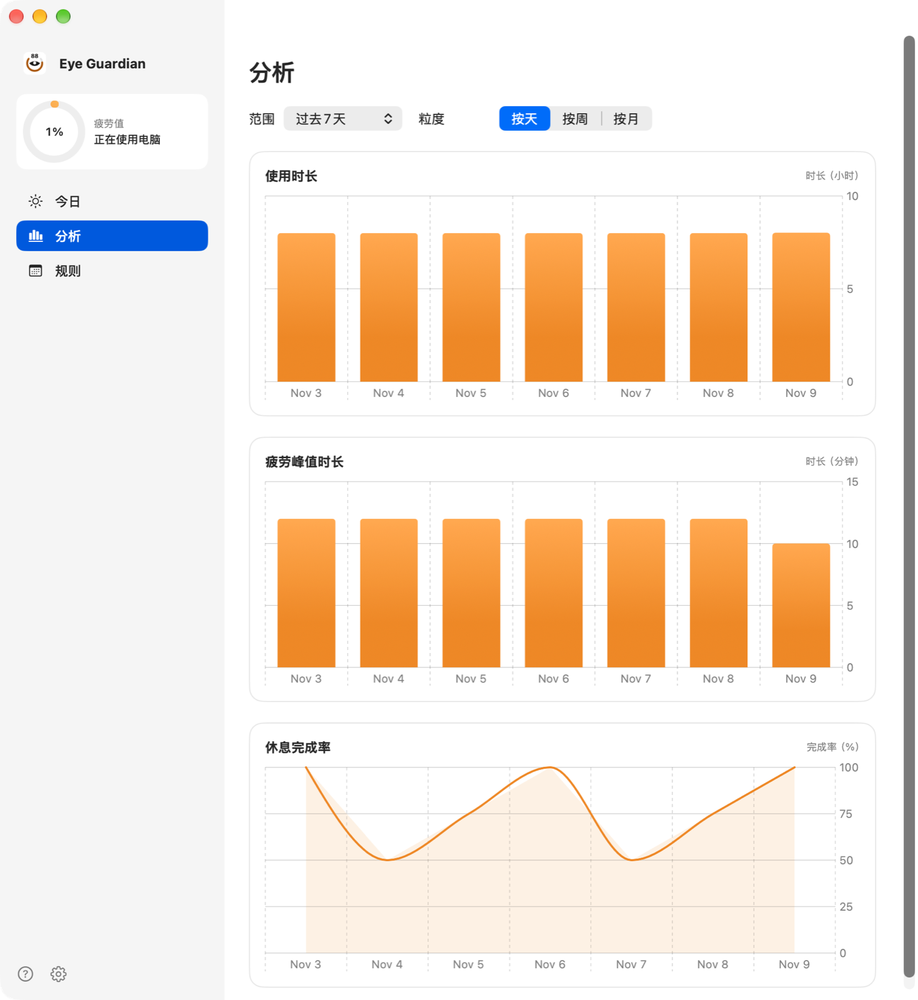

# Eye Guardian

Eye Guardian is a native macOS break-reminder app. It accumulates fatigue based on time spent using the computer and reminds you to rest when the fatigue level reaches a threshold; a completed break resets fatigue to zero. It is written in SwiftUI, AppKit and Swift Charts, supports macOS 13 and later, ships as a universal arm64 and x86_64 binary, and has no third-party dependencies.

The app needs no account, and usage records stay on this Mac. The interface is available in English and Simplified Chinese.

## Features

### Fatigue

By default, 40 minutes of work raises fatigue to 100%, and a 5-minute break restores it completely. Both durations can be adjusted. A reminder appears when fatigue reaches 100%; if you do not rest, it reminds you again at the repeat interval.

Usage detection determines when fatigue rises:

- Smart mode: mouse, keyboard or screen activity within 60 seconds counts as usage; 60 seconds without activity counts as rest.
- Dumb mode: all unlocked time counts as usage.
- Movie mode: ignores input detection and keeps counting while you watch videos.

Mouse and trackpad need no extra permission; the keyboard needs Accessibility; screen change detection needs Screen Recording. Lock screen and sleep always count as rest.

### Reminder styles

- Notification: appears in Notification Center and can start a break or skip directly.
- Mini popup: docks in the top-right corner of the screen without covering it.
- Full-screen popup: covers all screens. It stays until the countdown ends unless you skip.

When a popup style is selected, a pre-break notification can arrive 1 minute before the reminder. The popup background can follow the system, light, dark, purple, or a custom image; the reminder text and whether to show today's screen time can also be changed. Settings can additionally remind you when today's accumulated screen time reaches a threshold, for example 12 hours.

### Skipping and ending a break

Break skipping has three settings:

- Click the skip button to end the break immediately.
- Solve a multiplication problem first.
- No skip button.

A sound plays when a break ends. With "Lock screen when a break ends" enabled, the system locks immediately.

### Time-based rules

The Rules page sets work, break and repeat intervals by time window. Time outside the rules uses the default durations; windows can cross midnight. Rules match in order, and the first enabled rule takes effect.

### Status icon and shortcuts

The menu bar or Dock icon shows a fatigue progress ring. The ring style can be solid or dotted, grayscale or color, in three thicknesses, and the icon size can be set from 18 to 26 pt. The icon can show the fatigue percentage, today's screen time and today's reminder count; a pause mark appears while reminders are paused.

Left-click the menu bar icon to open the pause menu for 30 minutes, 1 hour, 2 hours, 6 hours or until tomorrow; right-click to open the full menu. The ⌃⌥⌘B shortcut starts a break from any app.

### Records and analysis

The Today page shows the fatigue curve, today's screen time and reminder count. The Analysis page provides three charts: screen time, fatigue peak duration and break compliance rate. The range can be the last 7 days, 28 days, 90 days, 12 months or all time; the granularity can be daily, weekly or monthly.

Data can be exported as CSV, aggregated by day: screen minutes, fatigue peak minutes, reminders, completions and completion rate.

## Install

macOS 13 or later and the Swift 6 Command Line Tools are required; full Xcode is not.

| Command | Purpose |
| --- | --- |
| `make` | Build the arm64 and x86_64 universal version, assemble and sign `build/Eye Guardian.app` |
| `make run` | Build and open the app |
| `make test` | Run the Core-layer tests |
| `make dmg` | Create a disk image that can be dragged into Applications |
| `make clean` | Remove build products |

The first build creates a local code-signing certificate with `openssl`, imports it into `~/Library/Keychains/EyeGuardian.keychain-db` and marks it trusted. The signing identity stays the same, so Accessibility and Screen Recording grants remain valid after rebuilding. Deleting that keychain changes the identity and requires granting permissions again. Set the `CODESIGN_ID` environment variable to use a different signing identity.

## Updates

Release builds check GitHub Releases once per day and on the first launch after that interval. Manual checks are available from the app menu, the status bar menu, and Settings → About. The update card shows the release notes and downloads the disk image only after confirmation.

The downloaded DMG is verified against the Ed25519 signature published with the release and the GitHub asset digest, then opened in Finder. Drag Eye Guardian into Applications, replace the old copy, and reopen it. The app does not replace itself or request administrator credentials.

Local builds set `UpdateEnabled` to false in `Info.plist`, so they never check for updates. The Release workflow sets it to true and signs the app with a stable certificate.

The first release that contains the updater must be installed manually. Moving from an ad-hoc signed build to the release certificate resets Accessibility and Screen Recording permissions once; the app shows the existing permission guide when that happens.

## Permissions

- Accessibility: reads global keyboard input. Without it, only mouse and trackpad activity is counted.
- Screen Recording: used only when "Detect screen changes" is enabled. Detection produces a 32×20 grayscale fingerprint that stays in memory.
- Notifications: shows notification banners and pre-break reminders. Requested on first launch.

Both System Settings and in-app prompts can open the relevant permission.

## Usage

The main window opens at launch. The language follows the system by default and can be fixed to English or Simplified Chinese in Settings → General; changes apply immediately. Launch at login is available.

"Settings → Reminders" adjusts reminder style, pre-break notification, skip behavior, sound, screen lock and the extra reminder; "Settings → Detection" adjusts usage detection; "Settings → Status Bar" and "Settings → Appearance" adjust the icon and popups. The preview at the top of these pages updates as you change settings.

## Data and privacy

Usage records are stored in `~/Library/Application Support/EyeGuardian/events.sqlite3`. The database writes one record per minute containing the fatigue level and whether you were using the computer; reminder start and completion times are also recorded. The app does not upload this data.

Screen change detection compares thumbnails in memory only and writes nothing to disk. It does not capture the screen when the feature is off.

## Project structure

| Path | Contents |
| --- | --- |
| `Sources/EyeGuardian/Core` | Settings, fatigue math, scheduling, rules, SQLite store, CSV export |
| `Sources/EyeGuardian/Platform` | Event monitoring, permissions, status bar, Dock icon, windows, screen lock |
| `Sources/EyeGuardian/UI` | SwiftUI views |
| `Sources/EyeGuardian/Update` | Version checks, GitHub release parsing, signature verification, DMG mounting |
| `Sources/EyeGuardianApp` | App entry point |
| `Tests` | Core-layer tests |
| `scripts/build.swift` | Universal build, icon generation, signing, disk image |
| `scripts/generate-release-keys` | One-time release certificate and Ed25519 key setup |
| `scripts/update-key.swift` | Ed25519 key generation and DMG signing |
| `scripts/update-smoke.sh` | Local download, signature, and DMG mount smoke test |

## Development

The Core layer does not depend on AppKit; tests use Swift Testing. `make test` adds the plugin and framework search paths for the Command Line Tools; running `swift test` directly may fail to find the `Testing` module.

`swift build` compiles only the current architecture in debug; use `make` for a distributable app and disk image.

## License

This project is licensed under the GNU Affero General Public License v3.0 (AGPL-3.0); see [LICENSE](LICENSE) for the full text.
